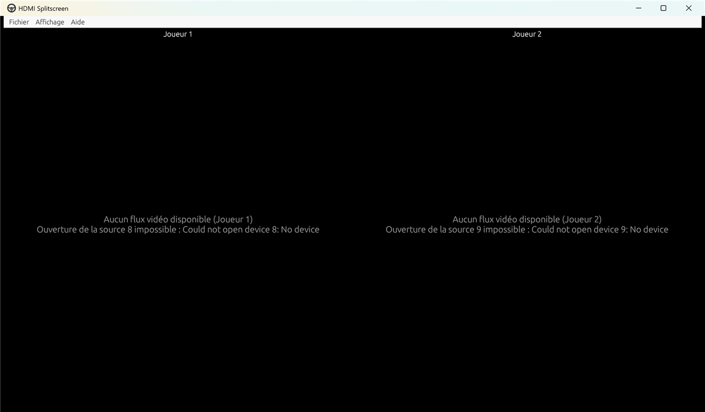
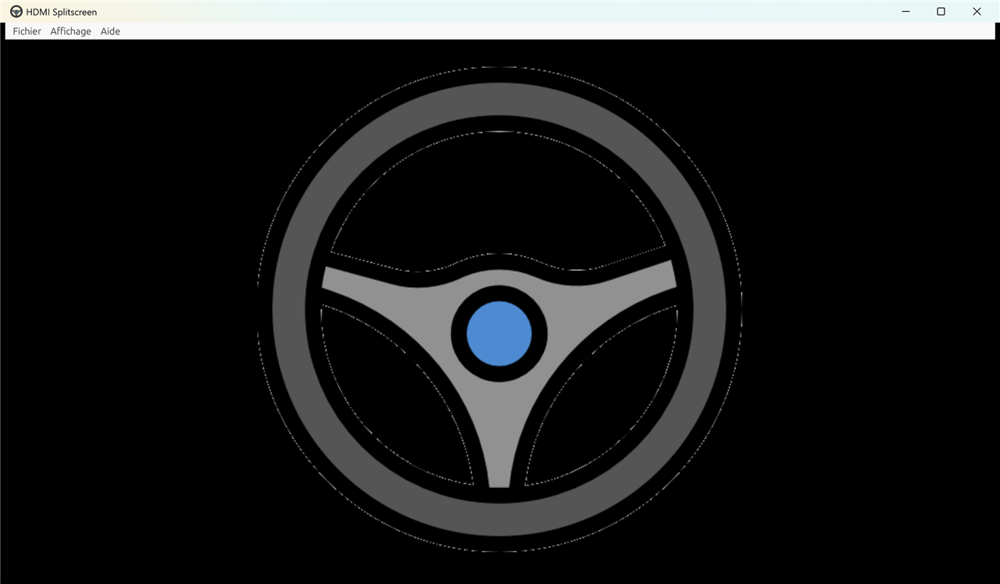

# HDMI Splitscreen

Affiche plusieurs cartes de capture HDMI (USB) **côte à côte** dans une seule fenêtre, avec le moins de latence possible.
Pensé pour un simulateur ou du jeu en écran partagé : chaque console ou PC branché en HDMI apparaît dans sa propre colonne.

**Version 1.0.0** · Windows · écrit en Rust · par Mikaël Côté

> L'ancienne version Python est conservée dans la branche [`old-python`](../../tree/old-python).


*Deux flux configurés côte à côte — capture prise sans carte de capture branchée.*

---

## Sommaire
- [Installation](#installation)
- [Premier démarrage](#premier-démarrage)
- [Utilisation](#utilisation)
- [Réglages (config.json)](#réglages-configjson)
- [Installer sur un autre PC](#installer-sur-un-autre-pc)
- [Dépannage](#dépannage)
- [Pourquoi c'est rapide](#pourquoi-cest-rapide)

---

## Installation

Il n'y a rien à installer : l'application tient dans **un seul fichier `hdmi-splitscreen.exe`**.

1. Ouvre l'onglet **[Actions](../../actions)** du dépôt.
2. Clique sur la dernière compilation réussie ✅.
3. En bas de la page, télécharge **hdmi-splitscreen-windows** (un .zip qui contient le .exe).
4. Mets le .exe dans un dossier où tu peux écrire (ex. Bureau ou `C:\HDMI Splitscreen\`). Évite `C:\Program Files\`.

## Premier démarrage

1. Branche tes cartes de capture USB **avant** de lancer l'application.
2. Double-clique sur `hdmi-splitscreen.exe`.
   Si Windows affiche « Windows a protégé votre ordinateur » : **Informations complémentaires → Exécuter quand même** (l'exe n'est pas signé).
   Tant qu'aucun flux n'est configuré, l'application affiche son logo :

   
3. Va dans **Fichier → Paramètres**.
4. Pour chaque carte, clique sur **➕ Ajouter un flux**, puis choisis :
   - **Source** : la carte de capture dans la liste (clique sur 🔄 **Rafraîchir** si elle n'apparaît pas) ;
   - **Nom à afficher** : le texte au-dessus de l'image (ex. « Joueur 1 ») ;
   - **Qualité** : 1280×720, 1920×1080 ou 640×480, et 60 ou 30 fps.
5. Clique sur **Enregistrer**. Les images apparaissent côte à côte, dans l'ordre de la liste.

## Utilisation

### Raccourcis
| Touche | Action |
|---|---|
| **F11** | Plein écran / fenêtre |
| **Échap** | Quitter le plein écran |

En plein écran, le menu est caché : **monte la souris tout en haut de l'écran** pour le faire apparaître.

### Menus
| Menu | Option | Effet |
|---|---|---|
| **Fichier** | Paramètres | Ajouter, retirer, activer ou désactiver des flux ; choisir la source et la qualité ; V-Sync |
| **Affichage** | Plein écran | Comme F11 |
| | Garder les proportions | Coché : bandes noires pour garder le 16:9. Décoché : l'image remplit toute la colonne (étirée) |
| | Afficher les noms | Affiche le nom de chaque flux au-dessus de l'image |
| | Afficher les infos (résolution, fps) | Affiche le format reçu, la résolution et les fps réels, ex. `MJPEG 1280×720 · 60 fps` |
| **Aide** | À propos | Version et créateur |

Avec « Afficher les noms » **et** « Afficher les infos » décochés, la barre du haut disparaît et l'image prend toute la hauteur.

### Dans les Paramètres
- **Activer** (pastille verte/rouge) : désactive un flux sans le supprimer.
- **❌ Supprimer** : retire le flux.
- **Synchro verticale (V-Sync)** : laisse-la **désactivée** pour le moins de lag. Active-la seulement si tu vois l'image se « déchirer ». Demande de redémarrer l'application.

Si une carte est débranchée ou ne répond pas, sa colonne affiche « Aucun flux vidéo disponible » avec la raison (comme sur la capture en haut de cette page).

## Réglages (config.json)

Tous les réglages sont enregistrés automatiquement dans **`config.json`, à côté du .exe**. Il est créé au premier lancement.

```json
{
  "streams": [
    {
      "name": "New Stream",
      "source": 0,
      "display_name": "Joueur 1",
      "enabled": true,
      "device_name": "USB Video",
      "width": 1280,
      "height": 720,
      "fps": 60
    }
  ],
  "keep_aspect": true,
  "show_labels": true,
  "show_info": true,
  "vsync": false
}
```

- `source` est le numéro de la carte (0, 1, 2…). `device_name` sert à retrouver la bonne carte si l'ordre des ports USB change.
- Un `config.json` de l'ancienne version Python fonctionne tel quel.
- Pour repartir de zéro : ferme l'application et supprime `config.json`.

## Installer sur un autre PC

1. Copie `hdmi-splitscreen.exe` (et `config.json` si tu veux garder tes réglages) dans un même dossier sur l'autre PC.
2. Lance l'exe. Rust n'a **pas** besoin d'être installé.
3. Vérifie les sources dans **Fichier → Paramètres** : les cartes peuvent avoir d'autres numéros sur un autre PC.

## Dépannage

| Problème | Solution |
|---|---|
| Une carte n'apparaît pas dans la liste | Rebranche-la, puis **🔄 Rafraîchir**. Ferme les autres logiciels qui l'utilisent (OBS, Discord, Caméra…) : une carte ne peut servir qu'à une application à la fois |
| « Aucun flux vidéo disponible » | Vérifie que la console/PC est allumé et que le câble HDMI est bien branché. Essaie une autre qualité (720p / 30 fps) |
| Les fps sont plus bas que prévu | Branche chaque carte sur un port USB différent (idéalement USB 3, bleu). Deux cartes 1080p60 sur un même hub USB 2 ne passent pas |
| Image déchirée horizontalement | Active le V-Sync dans les Paramètres et redémarre (un peu plus de lag) |
| `VCRUNTIME140.dll` introuvable | Installe le « Microsoft Visual C++ Redistributable x64 » depuis le site de Microsoft |
| Fenêtre noire / l'app ne démarre pas | Mets à jour les pilotes de ta carte graphique (l'affichage utilise OpenGL) |
| Les réglages ne sont pas sauvegardés | Le dossier de l'exe est en lecture seule : déplace l'exe ailleurs (pas dans `Program Files`) |

### Structure du code
| Fichier | Rôle |
|---|---|
| `src/main.rs` | Démarrage, fenêtre, icône |
| `src/app.rs` | Interface : affichage côte à côte, menus, Paramètres, À propos |
| `src/capture.rs` | Un thread par carte : ouverture, choix du meilleur format, lecture des images, calcul des fps |
| `src/convert.rs` | Conversion des images (MJPEG, YUYV, NV12) en RGBA |
| `src/config.rs` | Lecture / écriture de `config.json` |
| `assets/` | Logo et icône de l'application |

## Pourquoi c'est rapide

| | Ancienne version Python | Version Rust |
|---|---|---|
| Thread de capture | boucle à 100 % CPU | attend la prochaine image (0 % CPU à vide) |
| Redimensionnement | LANCZOS sur le CPU à chaque image | fait par la carte graphique |
| Affichage | timer toutes les 10 ms | redessine dès qu'une image arrive |
| Format | 640×480, sans choix | 720p/1080p, meilleur format détecté (non compressé si possible, sinon MJPEG) |
| Décodage MJPEG 720p | OpenCV + conversions | ~1,3 ms par image |

Pour le moins de lag : **V-Sync désactivé**, et chaque carte sur son propre port USB 3.
